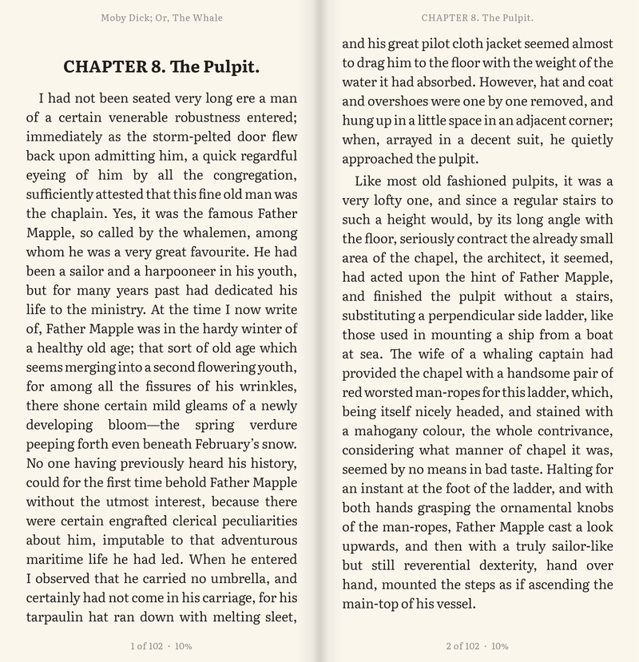
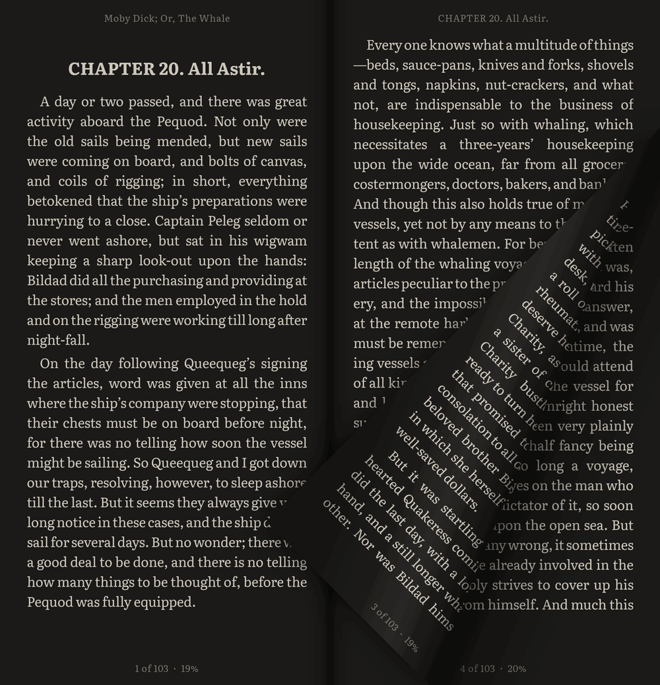
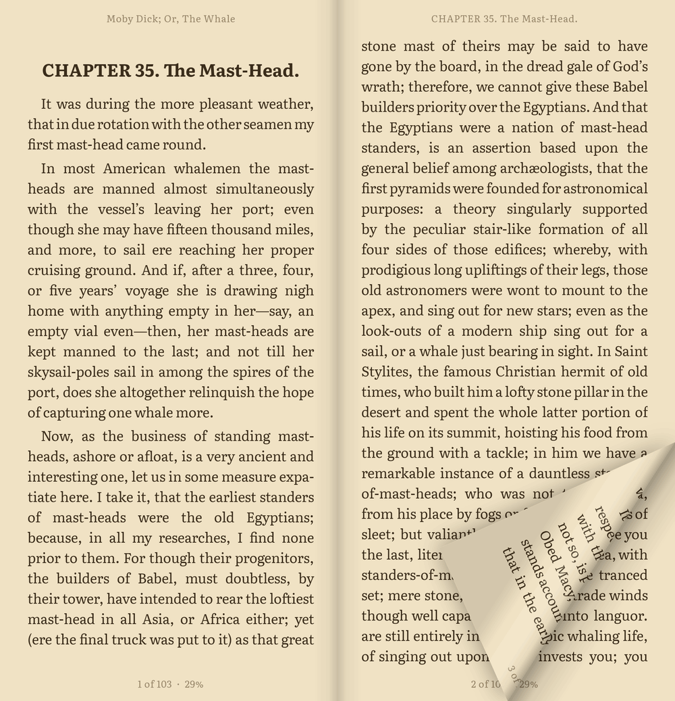
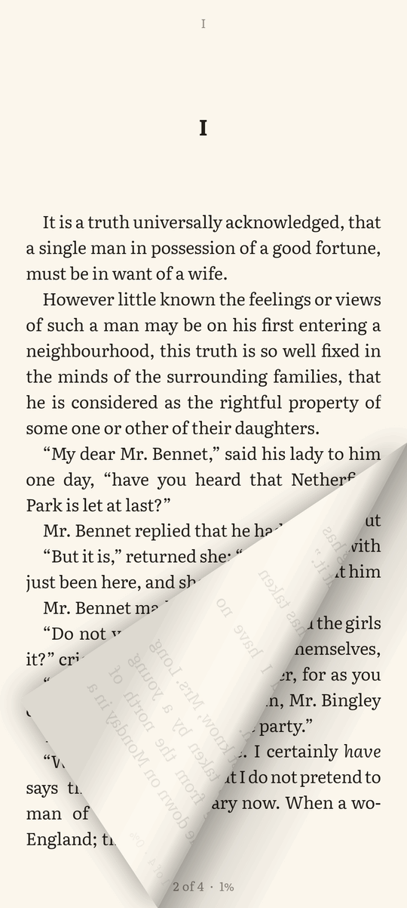
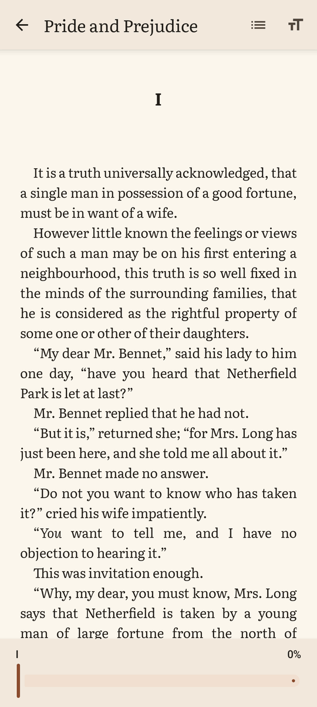
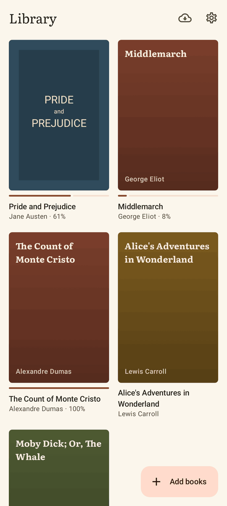
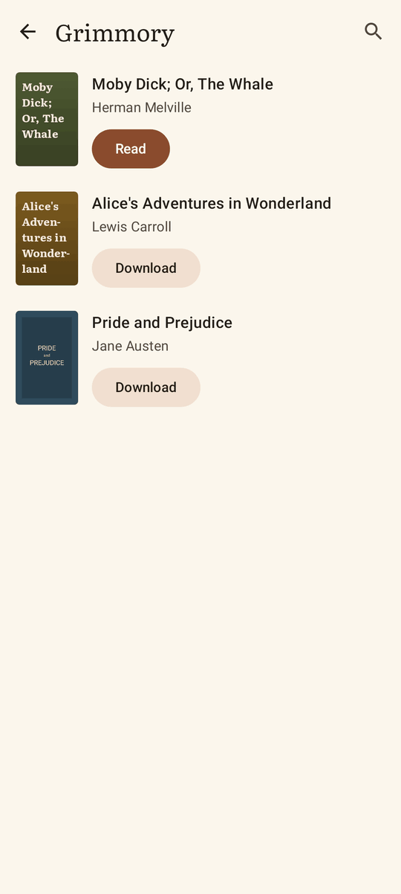
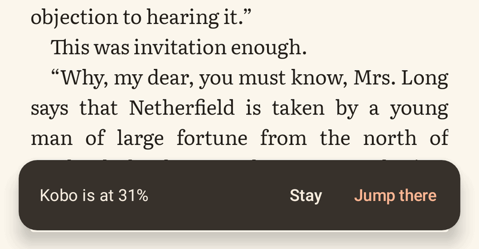

# Folio

An EPUB reader for Android that opens like a book when your phone does.

<p align="center">
  
</p>

<table>
  <tr>
    <td></td>
    <td></td>
  </tr>
</table>

Folded, it is one page at a time, with your library and your OPDS catalogs a tap away.

<table>
  <tr>
    <td></td>
    <td></td>
    <td></td>
    <td></td>
  </tr>
</table>

It picks up where your other reader stopped, through a KOReader sync server such as [Grimmory](https://github.com/grimmory-tools/grimmory).

<p align="center">
  
</p>

## Install

Download the APK from the [latest release](https://github.com/cfbender/folio/releases/latest). It needs Android 8.0 or newer.

## Build

With JDK 21 and the Android SDK:

```sh
./gradlew :app:assembleDebug        # app/build/outputs/apk/debug/app-debug.apk
./gradlew :app:testDebugUnitTest    # tests
./gradlew :app:lintDebug            # lint
```
